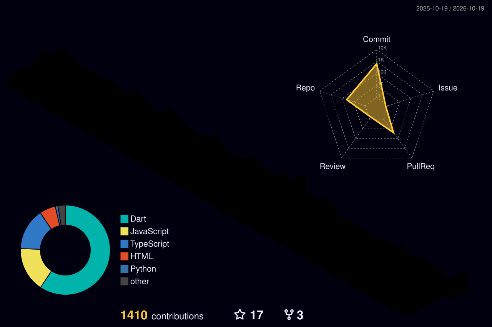

<!-- Colours match nazibullahnoyon.me: ink #07080c · client #4cc2ff · server #ff4d6d · ops #ffb547 · craft #b48cff -->

  

  

  
  
  

---

### ⚡ About

- 🛡️ **Cyber security researcher** — vulnerabilities, malware, zero-days and ML-based defences.
- 📱 **Software engineer** — **35+ cross-platform apps** shipped to Google Play and the App Store.
- 🔗 **Full-stack** across the Flutter client and the NestJS / Firebase backend behind it.
- 👥 Flutter Developer at **ScaleUp Ads Agency**, leading and mentoring a **14-person team**.
- 🎓 BSc CSE, Primeasia University — thesis: [ML for network intrusion detection](https://github.com/noyon-360/ML-in-Cyber-security) (98% accuracy, XGBoost & RF).

  
  
  
  

---

### 🧰 Toolkit

| | |
|---|---|
| 🛡️ **Security** |  &nbsp; Burp Suite · Nmap · Metasploit · MobSF · OWASP Juice Shop · PortSwigger Labs |
| 📱 **Client** |  &nbsp; Clean Architecture · MVVM · Bloc · Riverpod · GetX |
| ⚙️ **Server** |  &nbsp; REST · Socket.IO · BullMQ · Stripe · ffmpeg/HLS |
| 🚀 **Ops** |  &nbsp; Codemagic · Shorebird OTA · PM2 · VPS |
| 🎨 **Craft** |  &nbsp; Branding · Arabic calligraphy · IoT robotics |

---

### 🔬 Security case studies

Scroll-driven 3D write-ups on [nazibullahnoyon.me/case-study](https://nazibullahnoyon.me/case-study):

| Case study | Topic |
|---|---|
| [Knowing where to stop](https://nazibullahnoyon.me/case-study/academic-portal-disclosure) | Responsible disclosure |
| [One install command, four servers](https://nazibullahnoyon.me/case-study/npm-supply-chain-attack) | npm supply-chain attack |
| [Nineteen months with the door open](https://nazibullahnoyon.me/case-study/mongodb-ransomware-attack) | MongoDB ransomware |
| [The Shwapno data breach](https://nazibullahnoyon.me/case-study/shwapno-data-breach) | Data breach |
| [WannaCry and EternalBlue](https://nazibullahnoyon.me/case-study/wannacry-eternalblue) | Ransomware worm |

---

### 📁 Selected work

| Project | What it is | Stack |
|---|---|---|
| **BeatX** | Solo-built streaming backend: multi-GB uploads → S3 → 4 HLS renditions on a job queue | NestJS · BullMQ · ffmpeg · S3 |
| **Exodus** | Bus booking: QR tickets, live bus tracking, pay on arrival | Flutter · Socket.IO · Stripe |
| **[AzloTV](https://github.com/noyon-360/flutter_flimsa_v2)** | Streaming app: series, reels, resume-where-you-stopped player | Flutter · GetX · Chewie |
| **[Envielite](https://github.com/FSDTeam-SAA/flutter_envielite)** | Offline in-flight tour guide, 300 m GPS geofences, 8 languages | Flutter · Geolocator |
| **[CosmoQuest](https://github.com/noyon-360/CosmoQuest)** | Learn exoplanets from NASA data, quizzes and leaderboards | Flutter · Firebase · NASA APIs |
| **[Couplio](https://github.com/noyon-360/couplio)** | Calorie tracker for two, QR pairing and live sync | Flutter · Firestore · Gemini |

Other projects: [Dhikr Application](https://github.com/noyon-360/Dhikr-Application) · [Primeasia CSE Waiver Calculator](https://github.com/noyon-360/primeasia-waiver)

---

### 📊 Activity

  

<!-- 3D contribution calendar — generated by .github/workflows/profile-3d.yml -->

  

---

  
  
  

  

