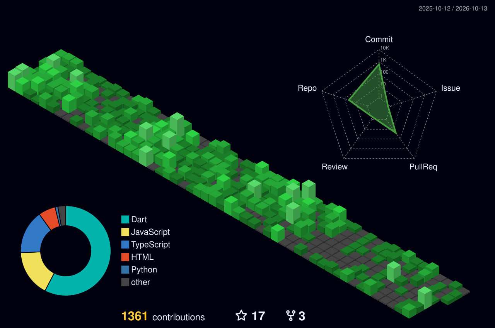

<!-- Terminal theme, matching nazibullahnoyon.me: ink #050806 · signal #39ff88 · alert #ff3b5c · warn #ffcc00 · trace #00e5ff -->

<p align="center">
  
</p>

<p align="center">
  <a href="https://nazibullahnoyon.me">
    
  </a>
</p>

<p align="center">
  <a href="https://nazibullahnoyon.me"></a>
  <a href="https://nazibullahnoyon.me/case-study"></a>
  
</p>

---

### `$ cat ./profile.txt`

```bash
name        : Nazibullah Noyon
role        : Cyber Security Researcher & Software Engineer
base        : Gazipur, Bangladesh  (UTC+06:00)
focus       : vulnerabilities · malware analysis · zero-days · ML-based defence
builds      : 35+ cross-platform apps live on Google Play & App Store
stack       : Flutter client  <->  NestJS / Firebase backend
team        : leading 14 engineers @ ScaleUp Ads Agency
thesis      : ML network intrusion detection — 98% accuracy (XGBoost, RF)
alignment   : white hat — every test authorised, every finding reported
```

---

### `$ cat ./mindset.md`

> **Attackers only need one gap. Defenders need to understand all of them.**
> I study how systems break so I can build ones that don't — and I write the apps myself, so I know where the weak seams hide.

| Phase | Hacker's mind | Engineer's discipline |
|---|---|---|
| 🔎 **Recon** | Map every input, endpoint and assumption | Know the architecture before writing a line |
| 🧪 **Probe** | Ask *"what if this is wrong?"* — then test it | Unit, widget, integration and golden tests |
| 🔐 **Harden** | Close the gap, then look for the next one | Auth guards, token refresh, secure storage |
| 📝 **Report** | Clear, reproducible, responsibly disclosed | Code review standards for a 14-person team |
| 🔁 **Repeat** | Curiosity doesn't clock out | CI/CD — 6 releases a month, 99% crash-free |

<p align="center">
  
</p>

<details>
<summary><b>📜 Rules of engagement</b></summary>

```text
[01] Only test what I'm authorised to test.
[02] Find it, prove it, report it — never exploit it for gain.
[03] Disclose responsibly; give owners time to fix.
[04] Protect user data as if it were my own.
[05] Share what I learn so others can defend better.
```

</details>

---

### `$ ls ./toolkit/`

| | |
|---|---|
| 🛡️ **offense → defense** |  &nbsp; Burp Suite · Nmap · Metasploit · MobSF · OWASP Juice Shop · PortSwigger Labs |
| 🧠 **ml security** |  &nbsp; XGBoost · Scapy · pandas · Jupyter |
| 📱 **client** |  &nbsp; Clean Architecture · MVVM · Bloc · Riverpod · GetX |
| ⚙️ **server** |  &nbsp; REST · Socket.IO · BullMQ · Stripe · ffmpeg/HLS |
| 🚀 **ops** |  &nbsp; Codemagic · Shorebird OTA · PM2 · VPS |

---

### `$ ls ./case-files/`

Scroll-driven 3D investigations on [nazibullahnoyon.me/case-study](https://nazibullahnoyon.me/case-study):

| File | Incident | Lesson |
|---|---|---|
| [`001`](https://nazibullahnoyon.me/case-study/academic-portal-disclosure) | Knowing where to stop | Responsible disclosure |
| [`002`](https://nazibullahnoyon.me/case-study/npm-supply-chain-attack) | One install command, four servers | Supply-chain trust |
| [`003`](https://nazibullahnoyon.me/case-study/mongodb-ransomware-attack) | Nineteen months with the door open | Exposed databases |
| [`004`](https://nazibullahnoyon.me/case-study/shwapno-data-breach) | The Shwapno data breach | Data protection |
| [`005`](https://nazibullahnoyon.me/case-study/wannacry-eternalblue) | WannaCry and EternalBlue | Patch management |

---

### `$ ls ./builds/`

| Project | What it does | Stack |
|---|---|---|
| **BeatX** | Solo-built streaming backend: multi-GB uploads → S3 → 4 HLS renditions on a job queue | NestJS · BullMQ · ffmpeg · S3 |
| **Exodus** | Bus booking: QR tickets, live bus tracking, pay on arrival | Flutter · Socket.IO · Stripe |
| **[AzloTV](https://github.com/noyon-360/flutter_flimsa_v2)** | Streaming app: series, reels, resume-where-you-stopped player | Flutter · GetX · Chewie |
| **[Envielite](https://github.com/FSDTeam-SAA/flutter_envielite)** | Offline in-flight tour guide, 300 m GPS geofences, 8 languages | Flutter · Geolocator |
| **[CosmoQuest](https://github.com/noyon-360/CosmoQuest)** | Learn exoplanets from NASA data, quizzes and leaderboards | Flutter · Firebase · NASA APIs |
| **[Couplio](https://github.com/noyon-360/couplio)** | Calorie tracker for two, QR pairing and live sync | Flutter · Firestore · Gemini |

Other: [ML in Cyber Security (thesis)](https://github.com/noyon-360/ML-in-Cyber-security) · [Dhikr Application](https://github.com/noyon-360/Dhikr-Application) · [Primeasia CSE Waiver Calculator](https://github.com/noyon-360/primeasia-waiver)

---

### `$ ./stats --live`

<p align="center">
  
  
  
  
</p>

<p align="center">
  
</p>

<!-- 3D contribution calendar — generated daily by .github/workflows/profile-3d.yml -->
<p align="center">
  
</p>

---

### `$ ping noyon`

<p align="center">
  <a href="https://nazibullahnoyon.me"></a>
  <a href="mailto:nazibullahnoyon19.20@gmail.com"></a>
  <a href="https://www.linkedin.com/in/nazibullah3nsn/"></a>
</p>

<p align="center"><code>// found a vulnerability in something I built? report it — I'll thank you, not fight you.</code></p>
